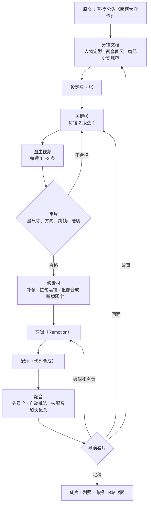

# 《南柯一梦》制作工作流

一个人当导演，两个 AI 代理干活，4 天做完一部 4 分钟的唐传奇短片。核心做法只有一条：**人只做判断，AI 做执行；AI 看不见、听不见的地方，用“量”来代替。**

这份文档把过程拆成可以照着做的十步，最后列出二十条经验。每一步的细节都有出处：分镜和提示词在 [storyboard.md](storyboard.md)，每一轮审片和导演意见在 [muse-review.md](muse-review.md)，脚本用法在 [production-notes.md](production-notes.md)。

## 谁做什么

| 角色 | 是谁 | 做什么 |
| --- | --- | --- |
| 导演、出品人 | dasungta | 选题；看每一版成片，按时间码提意见；在候选里拍板（选图、选声音、选封面）。全程没有画一张图、写一行代码 |
| 编剧、剪辑、配乐、导演 | Opus 5.5（在 Claude Code 桌面版里） | 剧本、分镜、提示词；在内置浏览器里给 Muse 发任务、下载、验收；写 Python 工具修素材；用 Remotion 剪辑、合成配乐、给配音对位、排海报 |
| 摄影、美术 | Muse（muse.ai 上的 AI 代理） | 设定图、关键帧、图生视频、书法片名、海报和封面的画 |
| 配音 | VoxCPM2 语音合成（自建服务） | 克隆参考声音，录旁白和人物台词 |

## 数字

| 项目 | 数量 |
| --- | --- |
| 成片 | 配音版约 4 分 05 秒，无配音版约 3 分 43 秒；1920×1080，24 帧，中英双语字幕 |
| 镜头 | 41 个（片头加 40 镜），其中 39 镜的画面由 Muse 生成 |
| 周期 | 2026-10-15 至 10-18，4 天 |
| 出图 | 留下 160 多张：7 张设定图、48 张定稿关键帧，其余是候选和落选（被平台拒绝的没算） |
| 视频 | 留下 88 条，每条 10 秒；成片里每条只用最好的 3～9.5 秒 |
| 配音 | 4 个声音、53 句，录了 95 遍 |
| 修改 | 审片记录里有 30 多条导演意见，每条都写了怎么改的 |
| 代码 | 约 3700 行：剪辑、配乐、海报（JavaScript），修素材和配音（Python） |

## 流程总览

## 时间线

| 日期 | 做了什么 |
| --- | --- |
| 10-15 | 写分镜文档；出 7 张设定图。导演指出都城画成了圆城、国王坐在椅子上、“盘龙冈”画成山上卧龙，于是写下唐代史实规范，按它重做；出三组对照镜头的关键帧 |
| 10-16 | 其余关键帧和全部视频；第一版剪辑（画风转场、字幕、配乐）；补拍 4 镜，扩写梦中二十年 5 镜。导演说不知道典故的人看不懂：开头加古槐特写和蚂蚁进洞，重拍入梦那一镜，字幕全部改成白话；加人物名章，把每个人物定型 |
| 10-17 | 加“敌军出谷”“护丧回京”两镜，护丧回京改成背影构图重拍；配乐重新梳理；把梦里的运镜拉匀；做两版片头、职员表和英文字幕；剧照、海报、封面 |
| 10-18 | B站封面；配音三轮（旁白加厚、使者统一成一个声音、国王改苍老）；看片后微调，定稿 |

## 十步做法

### 1. 分镜文档：一份随时更新的“活文档”

动手之前，先写一份文档，以后每条意见都先改它。[storyboard.md](storyboard.md) 是它的导出版，里面有：

- **故事**：情节和关键台词照原文，只删支线。全片靠一个反转立住：梦里二十年的荣华，醒来只是槐树下的一窝蚂蚁，杯里的酒还没干。
- **对照镜头**：梦里一镜、梦外一镜，同构图换画风，揭穿时观众自己对上。比如 S09 大殿上的国王对 S22 蚁穴里丹色土台上的两只大蚁，S14 逶迤的盘龙冈对 S24 老根旁一尺高的小土堆。做法是先出梦里那一镜，选定后拿它当构图参考出梦外那一镜。
- **两套画风**：梦外是写实古装电影，梦里是唐代工笔重彩。每套写一段固定的风格后缀，拼进每条提示词，绝不混用。画风只在入梦、出梦两处切换，切换在后期做。
- **唐代史实规范**：城、宫殿、民居、坐具、衣冠、山水，每一项写“应该是什么、不要什么”，附出处。每条提示词、每张出图都对一遍。
- **人物定型**：每个人梦里梦外穿什么、多大年纪、参考哪张定稿图。
- **分镜表、逐镜提示词、字幕与旁白稿、配乐表**。
- **画面里一律不出现文字**：匾额、人物名章、字幕、片名都在后期加。

### 2. 设定图和关键帧：每镜两版，选一张

- Muse 一次最多出 4 张，所以一批发 2 个镜头、每镜 2 版。
- 先出 7 张设定图（主角写实版、主角工笔三个时期、紫衣使者、公主、国王、古槐宅院、大槐安国），定稿后当后面每一镜的参考图。
- 每张图都过一遍验收清单：
    1. **尺寸**：自己量，别信“16:9”。实际出过 3:1、2:1、2096×1184。
    2. **史实**：檐角、鸱尾、坐具、服色。Muse 给臣子穿过唐代皇帝专用的赭黄袍。
    3. **人物**：脸、年纪、胡子、发髻和前后镜头一致。
    4. **方向**：人马朝哪边走，车是进城还是出城。
    5. **多余的人**：不为故事服务的人一律不要。
- 改图优先“以定稿图为底图，只改一处”：去掉随从、只换脸、只把天上的叶子换成槐叶。这比重新描述一整张画稳得多。

Opus 是在 Claude 桌面版的内置浏览器里和 Muse 对话的：在一个专门的会话里发提示词，等它出图，用脚本把图下载到 `muse/`，再逐张验收。每次发完都要确认消息真的发出去了；Muse 说“做好了”也要看它的记录，有一次它报了成功，其实生成失败了。

### 3. 图生视频：写死机位，只用前半段

- 上传定稿关键帧，配一段视频提示词。每条 10 秒、1248×704、24 帧、带环境音，没有时长和运动强度的开关。
- 固定镜头这样写：“摄影机固定在三脚架上完全不动，构图始终与首帧一致”，再把不许变的陈设逐项写出来。照这个写法，第一轮 29 条过了 27 条。
- 越往后越走样（10 秒里平板御床变成了龙纹宝座），所以剪辑主要用前半段。
- 要运镜就写清怎么动。车要驶进一个比车小的树洞，机位不动时 Muse 会让车绕开；写成“镜头跟在车后缓缓推进，洞口越来越大，黑暗占满画面”就成了。
- 审片：ffprobe 看规格和音量，均匀抽 6 帧拼成一条看有没有走样，再逐帧量光流，看方向、跳帧和硬切。

### 4. 平台拒绝的画面：改成暗示

| 想画的 | 结果 | 改成 |
| --- | --- | --- |
| 仰头痛饮，酒顺着胡须流下 | 拒绝 | 刚放下碗，用袖子抹胡子 |
| 殿上伏拜的主角 | 拒绝 | 大殿空景；主角单独出一张纯白底的图，后期合成 |
| 檀萝兵冲锋、战后残骸 | 拒绝 | 藤萝爬满城墙；后来写“像敦煌壁画《张议潮统军出行图》那样只画行军，不画交战”也通过了 |
| 濒死的公主躺在床上 | 拒绝 | 纱帐垂下看不到人，只有她的披帛垂落在地 |
| 闪电暴雨 | 拒绝 | 雨后静止的夜景，风雨和闪电后期加 |
| 仆人用斧、锄、锹挖开树洞 | 拒绝 | 主角徒手扒开洞口的朽木 |
| “灵车”“丧服” | 生成失败 | 改写成“载着公主灵柩的马车”“素白长袍” |

规律：醉酒特写、跪伏的人、战争、死亡、拿工具挖洞，直接画容易被拦；换成暗示基本都能过，而且常常更含蓄、更好看。

### 5. 修素材：遇到一个问题，写一个小工具

| 问题 | 工具 | 做法 |
| --- | --- | --- |
| 视频每 24 帧有一步走了两倍远，每秒顿一下 | `tools/dejudder.py` | 逐帧量光流找出缺口，用光流插一帧 |
| 梦里运镜看着像帧率很低 | `tools/smooth_motion.py` | Muse 的运镜 8 帧一轮、忽快忽慢，工笔细线又没有运动模糊。拟合镜头运动把步子拉匀，再加相当于 180° 快门的拖影 |
| 平台不让画伏拜的人 | `tools/s09_figure.py` | 白底人物抠像，按唐制把赭黄袍改成绯袍，匹配颗粒和色调，合成进大殿 |
| 城门匾额要有「大槐安國」「南柯郡城」 | `tools/plaque_text.py` | 逐帧找到匾面，按透视贴泥金楷书；旗子从匾前经过时让它挡住字 |
| 绢画片头的墨色晕开 | `tools/make_opening.py` | 先补出一张空白旧绢，再按离树洞的远近加噪声，让画一块块渗进来 |
| 书法片名 | `tools/make_title.py` | Muse 写字（提示词把每个字拆成部件：“柯：木字旁加一个可”），再把墨从纸上揭成透明底 |
| 入梦、出梦的画风转场；环境声忽大忽小 | `tools/prep_clips.py` | 把转场逐帧烤进镜头开头；测每条环境声，统一电平 |
| B站 4:3 封面没有放字的地方 | `tools/make_bili_plate.py` | 用画里同一块绢的纹理往上接一段 |

两条教训：补帧前先确认那一大步是不是视频里的硬切，硬切处插帧会生出一帧鬼影（导演看出来过）；方向拍反了只能重拍，倒放会让马腿和车轮倒着走（导演也看出来过）。

### 6. 剪辑：用 Remotion 把剪辑写成代码

- `edl.json`：每一镜用哪条视频、从第几秒开始、用多长（无配音版 `dur`，配音版 `voDur`）。
- `src/Film.jsx`：叠化、人物名章（像电影介绍主演一样盖一方印）、主角闭眼睁眼的主观镜头、闪电、片头职员表、片名卡、字幕。
- `src/cues.json`：画面和配乐共用的时间点（睁眼、闪电），改一处两边一起动。
- 剪辑写成代码的好处：每条意见都是改几行再出片；同一个工程出了五个版本（写实片头、绢画片头、无片头，各有配音版和无配音版）。
- 剪辑手法照电影来：入睡前最后一眼是酒杯，醒来也先回到酒杯；两段 AI 镜头的运镜对不上时，按常规“切近景”，不去硬拼。

### 7. 配乐：纯代码合成

- `music/make-music.mjs` 用程序合成古琴、箫、笙、琵琶、埙、编钟、堂鼓和雷雨，不用采样。
- 一个主题贯穿全片：古琴引出，梦里笙和琵琶放大成盛景，公主死时箫独吹，结尾古琴和箫完整重现，最后一个泛音落在片名上。
- 每一句按镜头起点定时，时间线一变就重新生成，不拿旧的循环充数。
- AI 听不到：用响度包络每半秒一格，对着镜头起点查哪里断了档。最后一定要导演试听。

### 8. 配音：先录全，再改剪辑

- 流程：台词表 `muse/vo/lines.json` → `tools/voice.py` 逐句录音 → `tools/vo_place.py` 量每一遍的时长、停顿、语速、音高，自动挑最合适的一遍，清理、压缩、统一电平，按镜头对位。
- 同样的请求，服务给出的录音一模一样。所以每句的第二遍换一种语气写法。
- 先录全再定剪辑：模型自然语速每秒约 4 字，按每秒 5 字写的字幕稿念不下。没有让配音赶着念，而是把 16 个镜头加长。旁白最好不超过每秒 4.5 字，快了导演听得出来。
- 音色由参考音决定，文字描述管不住。旁白要更厚，靠后期处理（音高和共振峰降 7%，加胸腔的低频）；两句要是同一个声音，就拿前一句的录音当参考，让模型接着往下说。
- 老人的声音不靠低音高，靠慢、拖长、气声和一点颤。没有克隆任何真人演员的声音。
- 生僻字换成同音常用字送去合成（棼→焚、弁→变），字幕不变。
- 声音好不好是主观判断：做 3～4 个候选，拼成一个对比试听的文件，让导演挑。导演说“尾音拖长一点”，指的是情绪，像一声叹息，不是把字的时长拉长。

### 9. 海报和封面

- 画由 Muse 出，提示词里先给字留好位置：“人物放在画面高度 58%–78%，最下方 15% 是干净的地面，最上方留空”。字在 `src/Poster.jsx` 里排，用 Remotion 出图。
- B站封面：投稿是 4:3，别处会裁成 16:9，信息流在最下面约 15% 叠播放量和时长。先看了同类爆款的封面（表情强烈的脸，加两行特大号的字），但导演最后选了片子自己的工笔画面。爆款公式是起点，不是答案。
- 缩到信息流卡片的大小（240×180）检查一遍。

### 10. 迭代：每条意见都落到文件里

- 导演看片，给出时间码和问题；Opus 先对照原文，再改提示词、重出画面或改剪辑，出新版。
- 每一轮的意见、试了什么、选了哪一版、为什么，都记进 [muse-review.md](muse-review.md)，分镜文档同步更新。
- 这样改了几十轮之后，仍然说得清每个镜头为什么是现在这样；换一个新的对话，也能接着做。

## 二十条经验

**写给 AI 画面的**

1. 提示词只写看得见的形状，不写比喻。写“像一对触角”，它就真画一对触角；写“盘龙冈”，它就在山上画一条龙。
2. 尺寸、方向、帧率都自己量，不信生成方自己说的。
3. 改图就以定稿图为底图，一次只改一处。
4. 跨镜头的连续性：把上一镜实际的最后一帧当参考图。
5. 视频写死机位和不许变的东西，只用前半段。
6. 被拒的画面改成暗示；被拒的人物单独出纯白底，再自己合成。
7. 方向错了只能重拍，不能倒放。
8. 补帧之前先找视频里的硬切。
9. 工笔画面的运镜要按“匀速加拖影”验收，光看有没有大跳帧不够。
10. 画面里不出现文字，字都在后期加；要书法字，就把每个字的部件拆开写。

**写给讲故事的**

11. 给不知道典故的人看：旁白用白话，反转直接说破，成语在片尾解释。
12. 关键的东西开头就给特写（老槐、树洞、蚂蚁），后面的揭穿才有伏笔。
13. 穿越到另一个世界，用一个看得清的镜头：车从观众认得的院子一路驶进那棵树。
14. 历史片先写史实规范再出图，奇幻只放在不违背史实的地方。
15. 画面里不要多余的人。

**写给声音的**

16. 配乐要慢、要低、要有强弱，一个主题贯穿到底；时间线变了就重写，不循环旧素材。
17. 配音先录全再改剪辑，旁白不超过每秒 4.5 字。
18. 音色看参考音；两句要一致，就让模型接着上一句说。

**写给人和 AI 协作的**

19. AI 听不到声音，也不能像人一样看片：能量化的都量，最后的主观判断交给人，并且给出可以对比的选项。
20. 每轮意见和处理都写进记录。文件名只用英文和数字：工程从 Mac 拷到 Windows 时，中文文件名整批乱码过。

## 照着做一部自己的片子

1. 选一个有反转、篇幅短的故事，找到原文。
2. 让编程代理（这次是 Claude Code）照 [storyboard.md](storyboard.md) 的结构写分镜文档：梗概、人物定型、画风后缀、史实规范、分镜表、逐镜提示词、字幕稿、配乐表。
3. 出设定图，定稿。
4. 逐镜出关键帧（2 版选 1），再出视频，审片。
5. 建 Remotion 工程。可以直接从这个仓库改：换掉 `edl.json`、`src/subs.js` 和 `muse/` 里的素材。
6. 配乐、配音、字幕。
7. 看片、修改、记录，循环到满意。
8. 剧照、海报、封面，发布。

## 用到的工具

- Claude Code 桌面版，模型 Opus 5.5；Muse 在它的内置浏览器里登录使用
- Muse（muse.ai）：出图、出视频
- Remotion 4.0.534、React 19.3.0、Node.js：剪辑、海报、出片
- Python 3.12、OpenCV、NumPy、Pillow、ffmpeg：修素材、配音处理
- VoxCPM2：配音（自建的 Gradio 服务）
- 字体：AR PL UKai（楷书，字幕和片头）、思源宋体（封面大字）
